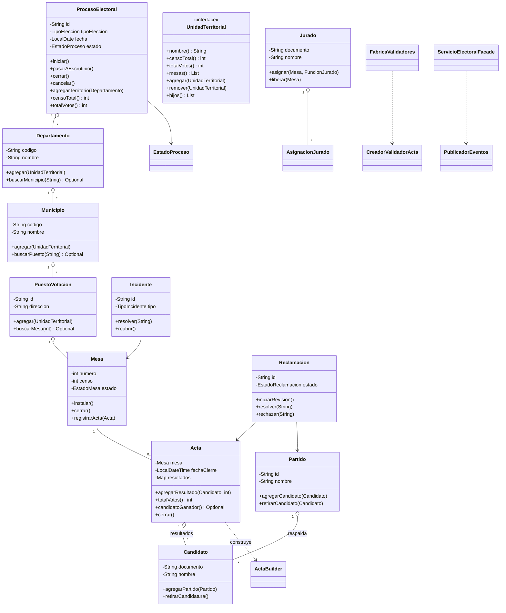
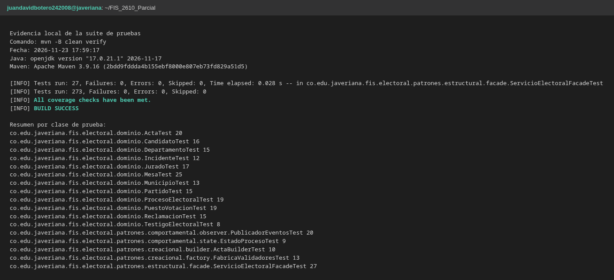
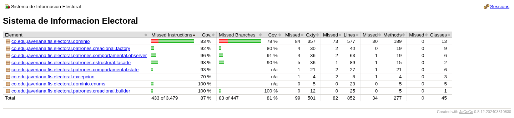
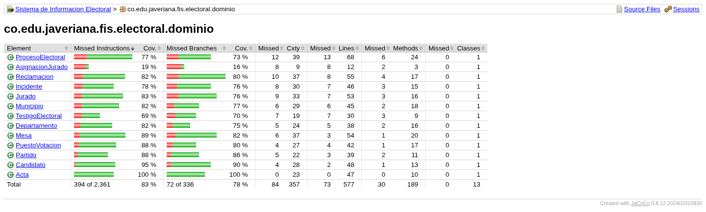
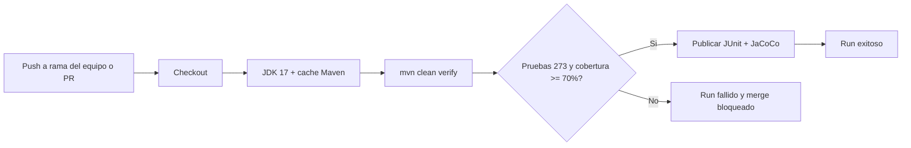
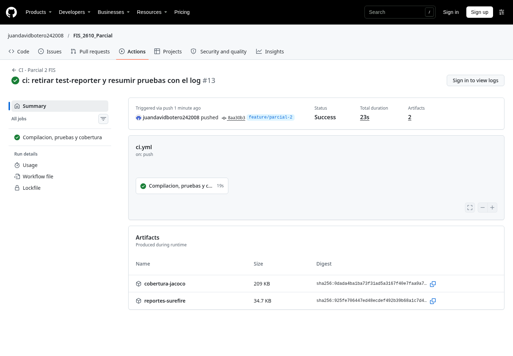
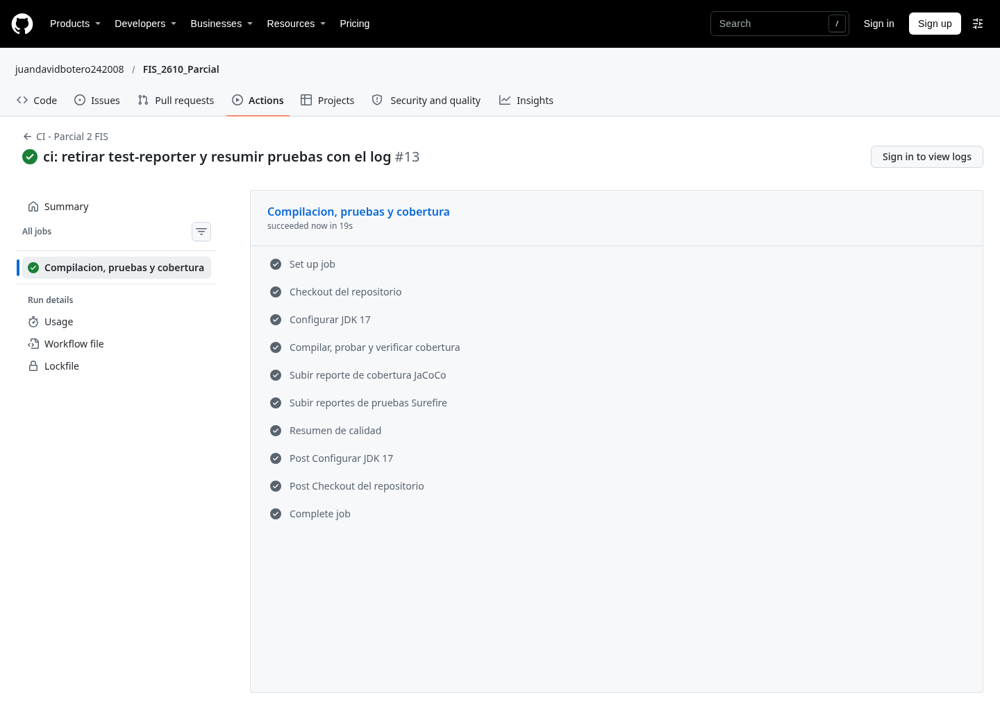
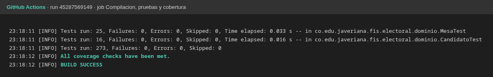
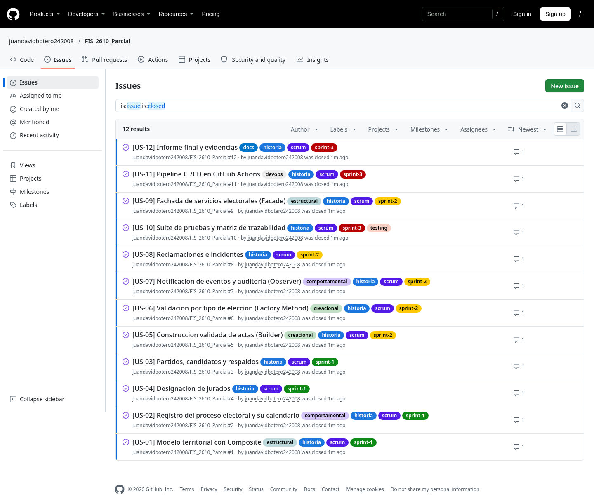
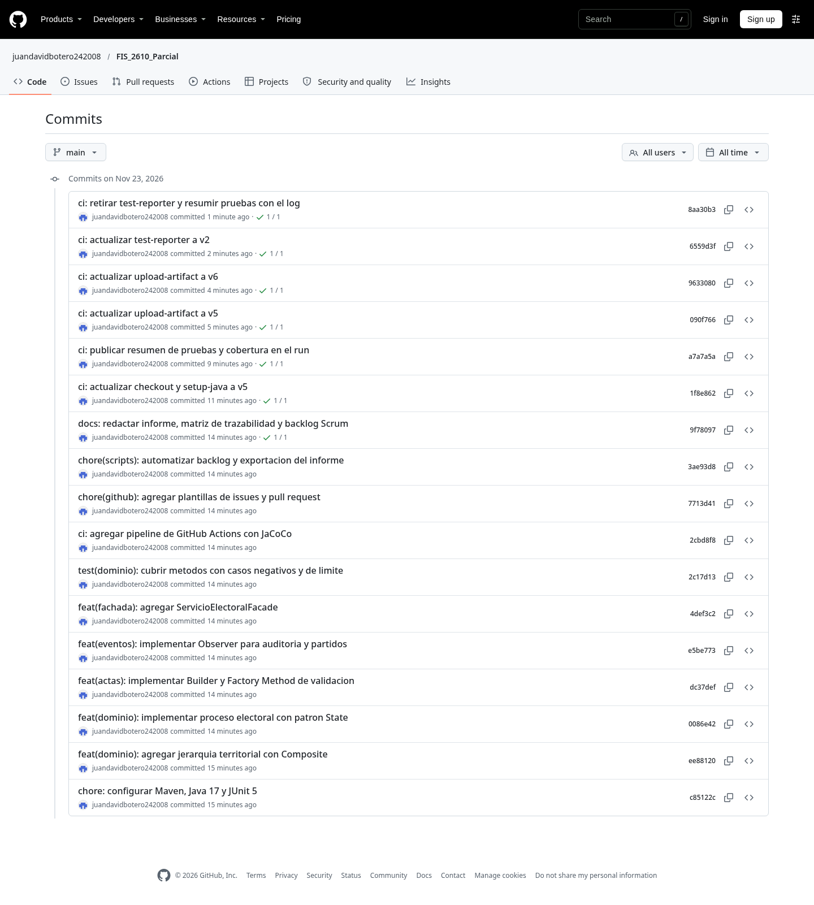

# Sistema de Información para la Gestión, Transparencia y Análisis del Proceso Electoral en Colombia

**Pontificia Universidad Javeriana — Departamento de Ingeniería de Sistemas**

**Segundo Parcial — Fundamentos de Ingeniería de Software**

| Campo | Valor |
|---|---|
| Integrantes | [Nombre 1] — [Nombre 2] |
| Docente | [Nombre del docente] |
| Fecha de entrega | [DD/MM/2026] |
| Repositorio | `https://github.com/juandavidbotero242008/FIS_2610_Parcial` |
| Rama del equipo | `feature/parcial-2` |
| Stack | Java 17 · Maven 3.9 · JUnit 5 · JaCoCo · GitHub Actions |

---

## Resumen ejecutivo

El proceso electoral colombiano involucra actores, etapas y una logística territorial compleja que suele gestionarse en sistemas fragmentados. Este proyecto implementa una base de software en Java 17 que modela de forma integral el proceso: calendario electoral, distribución territorial, partidos y candidatos, jurados, actas de escrutinio, incidentes, reclamaciones y consolidación de resultados.

La solución aplica **seis patrones GoF**, dos por categoría: **Builder** y **Factory Method** (creacionales), **Composite** y **Facade** (estructurales), **State** y **Observer** (comportamentales). Cada patrón responde a una situación concreta del dominio y está verificado mediante pruebas automatizadas.

La suite contiene **273 pruebas unitarias** (JUnit 5), con **87.55 % de cobertura de instrucciones** y **81.43 % de ramas**. El proyecto integra un pipeline de **GitHub Actions** que compila, ejecuta las pruebas, genera el reporte de JaCoCo y aplica un *quality gate* del 70 % de cobertura. La gestión se organizó con **12 historias de usuario** en tres sprints, issues de GitHub y *Conventional Commits*.

---

## Contenido

1. [Introducción](#1-introducción)
2. [Análisis y diseño del dominio](#2-análisis-y-diseño-del-dominio)
3. [Patrones GoF implementados](#3-patrones-gof-implementados)
4. [Pruebas unitarias](#4-pruebas-unitarias)
5. [Integración CI/CD](#5-integración-cicd)
6. [Gestión Scrum y Git](#6-gestión-scrum-y-git)
7. [Conclusiones](#7-conclusiones)
8. [Referencias](#8-referencias)
9. [Anexos](#9-anexos)

---

## 1. Introducción

### 1.1 Contexto

En las elecciones legislativas de 2026 la autoridad electoral debe coordinar la inscripción de candidaturas, la designación de jurados, la instalación de mesas, el escrutinio y la publicación de resultados. La información se distribuye entre departamentos, municipios, puestos de votación y mesas, y convive con actores políticos que auditan el proceso.

El enunciado plantea un sistema que soporte **planeación, seguimiento, auditoría, trazabilidad y analítica de resultados**. El reto de diseño no es solo almacenar datos: es representar reglas que cambian según la etapa del calendario y el tipo de elección, consolidar información jerárquica y notificar a múltiples interesados sin acoplar el sistema.

### 1.2 Problema

Sin un modelo unificado aparecen cuatro problemas:

1. **Información fragmentada** entre lo administrativo (procesos, candidatos), lo logístico (territorio, mesas, jurados) y los resultados (actas).
2. **Reglas dispersas**: las validaciones de un acta dependen del tipo de elección y de la etapa del proceso.
3. **Falta de trazabilidad**: no queda claro quién registró un acta, qué reclamaciones se radicaron ni cómo evolucionó el proceso.
4. **Consolidación manual**: sumar votos por municipio o departamento es propenso a errores cuando la jerarquía es profunda.

### 1.3 Objetivos

**Objetivo general:** diseñar e implementar un sistema orientado a objetos que modele el proceso electoral colombiano, aplicando patrones GoF, pruebas unitarias y automatización CI/CD.

**Objetivos específicos:**

- Modelar la jerarquía territorial y consolidar censo y votos de forma recursiva.
- Controlar el ciclo de vida del proceso electoral y de las mesas con transiciones válidas.
- Construir actas de escrutinio con validaciones centralizadas y reglas por tipo de elección.
- Registrar incidentes y tramitar reclamaciones con estados y trazabilidad.
- Notificar eventos a auditoría, analítica y partidos.
- Verificar el comportamiento con pruebas positivas, negativas y de límite.
- Automatizar compilación, pruebas y cobertura en cada push.

### 1.4 Alcance y supuestos

- **Alcance:** capa de dominio y servicios en memoria; no se implementa interfaz gráfica ni base de datos, porque la práctica evalúa diseño de clases, patrones, pruebas y DevOps.
- **Supuesto 1:** un proceso electoral tiene un único tipo de elección y una fecha.
- **Supuesto 2:** cada mesa tiene un censo positivo y un acta de cierre como máximo.
- **Supuesto 3:** las actas se registran durante la jornada o el escrutinio; después del cierre no se aceptan reclamaciones.
- **Supuesto 4:** la consolidación usa los votos de las actas registradas; las mesas sin acta aportan cero.

---

## 2. Análisis y diseño del dominio

### 2.1 Actores

| Actor | Interés principal |
|---|---|
| Autoridad electoral | Configurar el calendario, el territorio y validar actas |
| Funcionario de registro | Registrar procesos, partidos y candidatos |
| Jurado de votación | Instalar la mesa, cerrar la jornada y levantar el acta |
| Partido político | Respaldar candidatos y presentar reclamaciones |
| Testigo electoral | Vigilar la mesa y respaldar reclamaciones |
| Analista | Consolidar resultados y comparar territorios |

### 2.2 Procesos del negocio

1. **Planeación:** registrar el proceso (tipo, fecha, estado) y su distribución territorial.
2. **Conformación de la contienda:** registrar partidos, candidatos y respaldos.
3. **Logística:** habilitar puestos y mesas, designar jurados y funciones.
4. **Jornada:** instalar mesas, registrar incidentes y cerrar mesas.
5. **Escrutinio:** construir y validar actas, registrar resultados.
6. **Control:** radicar, revisar y resolver reclamaciones.
7. **Analítica:** consolidar por mesa, puesto, municipio o departamento.

### 2.3 Requisitos funcionales

| ID | Requisito | Entidades / patrón |
|---|---|---|
| RF-01 | Registrar procesos electorales con tipo, fecha y estado | `ProcesoElectoral`, State |
| RF-02 | Controlar transiciones del calendario electoral | State |
| RF-03 | Organizar departamentos, municipios, puestos y mesas | Composite |
| RF-04 | Registrar partidos y candidatos con respaldos | `Partido`, `Candidato` |
| RF-05 | Asignar jurados a mesas con una función | `Jurado`, `AsignacionJurado` |
| RF-06 | Instalar y cerrar mesas | `Mesa` |
| RF-07 | Construir actas de cierre con resultados | Builder |
| RF-08 | Validar actas según el tipo de elección | Factory Method |
| RF-09 | Registrar incidentes y reabrirlos si es necesario | `Incidente` |
| RF-10 | Radicar y tramitar reclamaciones | `Reclamacion` |
| RF-11 | Notificar eventos a auditoría, analítica y partidos | Observer |
| RF-12 | Consolidar censo, votos y participación por territorio | Composite, Facade |

### 2.4 Requisitos no funcionales

| ID | Requisito | Cómo se atiende |
|---|---|---|
| RNF-01 | Mantenibilidad | Separación por capas y paquetes; patrones con responsabilidades claras |
| RNF-02 | Extensibilidad | Factory Method permite nuevos tipos de elección sin tocar la fachada |
| RNF-03 | Confiabilidad | Validaciones de negocio y excepciones específicas |
| RNF-04 | Testabilidad | Inyección de dependencias, fixtures y pruebas aisladas |
| RNF-05 | Trazabilidad | Eventos de auditoría, estados explícitos y conventional commits |
| RNF-06 | Automatización | Pipeline de CI con quality gate de cobertura |

### 2.5 Modelo de clases



### 2.6 Decisiones de diseño

| Decisión | Justificación |
|---|---|
| Dominio en memoria | La práctica evalúa diseño, no persistencia; elimina dependencias externas y hace las pruebas deterministas. |
| Excepciones de dominio | `ValidacionElectoralException` y `TransicionEstadoInvalidaException` distinguen reglas de negocio de errores técnicos. |
| `UnidadTerritorial` común | Permite tratar de forma uniforme departamentos, municipios, puestos y mesas (base del Composite). |
| Validaciones en el constructor | Evita objetos inválidos y centraliza las precondiciones. |
| Fechas fijas en fixtures | Las pruebas no dependen del reloj del sistema. |
| Fachada para casos de uso | Los analistas no deben conocer validadores, estados ni observadores. |

---

## 3. Patrones GoF implementados

### 3.1 Resumen

| Categoría | Patrón | Clases principales | Pruebas |
|---|---|---|---|
| Creacional | Builder | `ActaBuilder`, `Acta` | 10 |
| Creacional | Factory Method | `CreadorValidadorActa`, `FabricaValidadores`, validadores | 13 |
| Estructural | Composite | `UnidadTerritorial`, `Departamento`, `Municipio`, `PuestoVotacion`, `Mesa` | 47 |
| Estructural | Facade | `ServicioElectoralFacade` | 27 |
| Comportamental | State | `EstadoProceso`, estados concretos, `ProcesoElectoral` | 28 |
| Comportamental | Observer | `PublicadorEventos`, `ObservadorElectoral`, observadores | 20 (+ fachada) |

### 3.2 Builder (creacional)

**Situación concreta.** Al cierre de la jornada, el jurado construye un acta con la mesa, la fecha y los votos de varios candidatos. Un constructor con todos esos parámetros sería difícil de leer y de validar; además, las reglas (sin votos negativos, sin candidatos duplicados, sin acta sin mesa) deben cumplirse antes de crear el objeto.

**Justificación.** Builder separa la construcción de la representación, permite una API fluida y concentra las validaciones en un único punto. Se descartó el constructor telescópico porque cada nuevo dato obligatorio obligaría a cambiar todas las llamadas, y se descartó crear el acta con setters porque permitiría objetos a medio construir.

**Participantes:**

- **Producto:** `Acta`.
- **Builder:** `ActaBuilder`.
- **Director (implícito):** la fachada y las pruebas encadenan los pasos.

```java
public class ActaBuilder {
    private Mesa mesa;
    private LocalDateTime fechaCierre;
    private final Map<Candidato, Integer> resultados = new LinkedHashMap<>();

    public ActaBuilder agregarResultado(Candidato candidato, int votos) {
        if (candidato == null) {
            throw new IllegalArgumentException("El candidato es obligatorio");
        }
        if (votos < 0) {
            throw new IllegalArgumentException("Los votos no pueden ser negativos");
        }
        if (resultados.containsKey(candidato)) {
            throw new ValidacionElectoralException(
                    "El candidato " + candidato.getNombre() + " ya fue agregado al acta");
        }
        resultados.put(candidato, votos);
        return this;
    }

    public Acta construir() {
        if (mesa == null) {
            throw new ValidacionElectoralException("No se puede construir un acta sin mesa");
        }
        LocalDateTime fecha = fechaCierre == null ? LocalDateTime.now() : fechaCierre;
        Acta acta = new Acta(mesa, fecha);
        resultados.forEach(acta::agregarResultado);
        return acta;
    }
}
```

**Explicación.** El builder acumula resultados en un `LinkedHashMap` (preserva el orden de registro), valida cada paso y solo en `construir()` verifica la precondición global. El acta resultante todavía debe cerrarse y validarse según el tipo de elección; el builder no asume esas responsabilidades para no mezclar creación con reglas de escrutinio.

**Pruebas.** `ActaBuilderTest` (10): creación válida, acta sin resultados (límite), fecha por defecto, ausencia de mesa (negativa), mesa/fecha nulas, votos negativos, candidato duplicado y fecha personalizada.

**Ubicación:** `src/main/java/co/edu/javeriana/fis/electoral/patrones/creacional/builder/`.

### 3.3 Factory Method (creacional)

**Situación concreta.** Las reglas de un acta dependen del tipo de elección. En una legislativa se exige al menos un candidato con votos; en una presidencial debe reflejarse una contienda con al menos dos; en una consulta popular la abstención total es un resultado válido. Si la fachada usara `if/else` por tipo, cada nueva elección obligaría a modificar el servicio y a repetir condicionales en las pruebas.

**Justificación.** Factory Method define una interfaz para crear el validador y deja que cada subclase decida cuál instanciar. Así se cumple el principio de abierto/cerrado: un nuevo tipo de elección agrega un creador y una rama en la fábrica, sin tocar el flujo de registro de actas.

**Participantes:**

- **Producto:** `ValidadorActa`.
- **Productos concretos:** `ValidadorLegislativo`, `ValidadorPresidencial`, `ValidadorConsulta`.
- **Creador:** `CreadorValidadorActa` (método fábrica `crearValidador()`).
- **Creadores concretos:** `CreadorLegislativo`, `CreadorPresidencial`, `CreadorConsulta`.
- **Selector:** `FabricaValidadores.para(TipoEleccion)`.

```java
public abstract class CreadorValidadorActa {

    /** Metodo fabrica: cada subclase produce su validador. */
    public abstract ValidadorActa crearValidador();

    public void validar(Acta acta) {
        crearValidador().validar(acta);
    }
}

public final class FabricaValidadores {
    public static CreadorValidadorActa para(TipoEleccion tipoEleccion) {
        if (tipoEleccion == null) {
            throw new IllegalArgumentException("El tipo de eleccion es obligatorio");
        }
        return switch (tipoEleccion) {
            case LEGISLATIVA -> new CreadorLegislativo();
            case PRESIDENCIAL -> new CreadorPresidencial();
            case CONSULTA_POPULAR -> new CreadorConsulta();
        };
    }
}
```

La regla diferenciadora se encapsula en cada producto:

```java
public class ValidadorPresidencial extends ValidadorActaBase {
    @Override
    protected void validarReglaEspecifica(Acta acta) {
        long conVotos = acta.getResultados().values().stream()
                .filter(votos -> votos > 0)
                .count();
        if (conVotos < 2) {
            throw new ValidacionElectoralException(
                    "Un acta presidencial debe registrar al menos dos candidatos con votos");
        }
    }
}
```

**Explicación.** `ValidadorActaBase` aplica las reglas comunes (acta no nula, votos no negativos y total menor o igual al censo) y delega la regla variable en `validarReglaEspecifica`. El método `validar` del creador usa el método fábrica, de modo que el cliente nunca instancia validadores concretos.

**Pruebas.** `FabricaValidadoresTest` (13): selección de cada creador, tipo nulo, acta válida y sin votos para legislativa (límite), un solo candidato en presidencial (límite), consulta sin votos (límite), exceso de censo en cada tipo y votos exactamente iguales al censo (límite).

**Ubicación:** `src/main/java/co/edu/javeriana/fis/electoral/patrones/creacional/factory/`.

### 3.4 Composite (estructural)

**Situación concreta.** La analítica requiere comparar resultados por mesa, puesto, municipio y departamento. Si cada nivel implementara su propia suma, habría cuatro algoritmos casi iguales y fáciles de desincronizar. Además, la jerarquía debe validar qué tipo de hijo acepta cada nivel y evitar duplicados o pertenencias cruzadas.

**Justificación.** Composite permite tratar objetos individuales (mesa) y composiciones (puesto, municipio, departamento) a través de la misma interfaz `UnidadTerritorial`. La consolidación se escribe una vez y se aplica recursivamente; agregar un nivel intermedio no cambia a los clientes.

**Participantes:**

- **Componente:** `UnidadTerritorial`.
- **Compuestos:** `Departamento`, `Municipio`, `PuestoVotacion`.
- **Hoja:** `Mesa`.

```java
public interface UnidadTerritorial {
    String nombre();
    int censoTotal();
    int totalVotos();
    List<Mesa> mesas();
    void agregar(UnidadTerritorial unidad);
    void remover(UnidadTerritorial unidad);
    List<? extends UnidadTerritorial> hijos();
}
```

```java
public class Departamento implements UnidadTerritorial {
    private final List<Municipio> municipios = new ArrayList<>();

    @Override
    public void agregar(UnidadTerritorial unidad) {
        if (!(unidad instanceof Municipio municipio)) {
            throw new ValidacionElectoralException(
                    "Un departamento solo puede contener municipios");
        }
        if (municipios.contains(municipio)) {
            throw new ValidacionElectoralException(
                    "El municipio " + municipio.getCodigo() + " ya existe en el departamento");
        }
        municipio.vincularDepartamento(this);
        municipios.add(municipio);
    }

    @Override
    public int censoTotal() {
        return municipios.stream().mapToInt(Municipio::censoTotal).sum();
    }

    @Override
    public int totalVotos() {
        return municipios.stream().mapToInt(Municipio::totalVotos).sum();
    }
}
```

La hoja corta la recursión y define los valores base:

```java
public class Mesa implements UnidadTerritorial {
    @Override
    public int censoTotal() {
        return censo;
    }

    @Override
    public int totalVotos() {
        return acta == null ? 0 : acta.totalVotos();
    }

    @Override
    public void agregar(UnidadTerritorial unidad) {
        throw new ValidacionElectoralException(
                "Una mesa es una hoja y no puede contener unidades hijas");
    }
}
```

**Explicación.** `censoTotal()` y `totalVotos()` se delegan hacia abajo y se suman con `mapToInt`. La validación de tipo impide construir jerarquías incoherentes (por ejemplo, un municipio dentro de un puesto) y la vincula en ambos sentidos para que `getPuesto()` y `getDepartamento()` sean consistentes. Las hojas rechazan operaciones de composición, tal como exige el patrón.

**Pruebas.** 47 pruebas de composición y consolidación distribuidas entre `DepartamentoTest`, `MunicipioTest`, `PuestoVotacionTest` y `MesaTest`. Cubren composición válida, tipo incorrecto, duplicados, pertenencia a otro padre, hojas, totales vacíos (límite) y consolidación de varios niveles.

**Ubicación:** `src/main/java/co/edu/javeriana/fis/electoral/dominio/`.

### 3.5 Facade (estructural)

**Situación concreta.** Registrar un acta no es una sola operación: hay que verificar la etapa del proceso, confirmar que la mesa pertenece al proceso, aplicar el validador del tipo de elección, cerrar el acta, asociarla a la mesa y publicar el evento de auditoría. Si un analista tuviera que coordinar todo eso, el caso de uso quedaría duplicado en cada cliente.

**Justificación.** La fachada ofrece una interfaz de alto nivel (`registrarActa`, `radicarReclamacion`, `consolidar`) y oculta la colaboración entre estado, validadores, repositorios en memoria, ciclo de vida de la mesa y observadores. Reduce el acoplamiento y hace que el caso de uso sea explícito y testeable.

**Participantes:**

- **Fachada:** `ServicioElectoralFacade`.
- **Subsistema:** `ProcesoElectoral`, `FabricaValidadores`, `Mesa`, `Acta`, `Reclamacion`, `PublicadorEventos`.

```java
public void registrarActa(Acta acta) {
    if (acta == null) {
        throw new IllegalArgumentException("El acta es obligatoria");
    }
    if (!(proceso.getEstado() instanceof EstadoEnCurso)
            && !(proceso.getEstado() instanceof EstadoEscrutinio)) {
        throw new TransicionEstadoInvalidaException(
                "Solo se registran actas durante la jornada o el escrutinio; estado actual: "
                        + proceso.estadoActual());
    }
    Mesa mesa = acta.getMesa();
    if (!proceso.mesas().contains(mesa)) {
        throw new ValidacionElectoralException("La mesa no pertenece al proceso electoral");
    }
    if (mesa.getEstado() != EstadoMesa.CERRADA) {
        throw new TransicionEstadoInvalidaException(
                "La mesa debe estar cerrada antes de registrar su acta; estado actual: "
                        + mesa.getEstado());
    }
    if (actas.containsKey(mesa)) {
        throw new ValidacionElectoralException(
                "La mesa " + mesa.getNumero() + " ya tiene un acta registrada");
    }
    FabricaValidadores.para(proceso.getTipoEleccion()).validar(acta);
    acta.cerrar();
    mesa.registrarActa(acta);
    actas.put(mesa, acta);
    publicador.publicar(new EventoElectoral(
            TipoEvento.ACTA_REGISTRADA,
            "MESA-" + mesa.getNumero(),
            "Acta registrada para la mesa " + mesa.getNumero(),
            null));
}
```

**Explicación.** El orden importa: primero se valida el contexto (etapa del proceso, pertenencia y cierre de la mesa), luego las reglas de escrutinio, después se cierra el acta y se asocia a la mesa, y solo si todo tuvo éxito se guarda y se publica el evento. Si la validación falla, el acta permanece abierta y no se notifica a nadie, lo que evita efectos parciales.

**Pruebas.** `ServicioElectoralFacadeTest` (27): registro exitoso, proceso no iniciado, mesa ajena, mesa aún no cerrada, exceso de censo, acta duplicada, acta nula, radicación con partido y con testigo, acta no registrada, id duplicado, proceso cerrado, transiciones de revisión, resolución, rechazo, consolidación, participación cero (límite) y dependencias nulas.

**Ubicación:** `src/main/java/co/edu/javeriana/fis/electoral/patrones/estructural/facade/`.

### 3.6 State (comportamental)

**Situación concreta.** El proceso electoral avanza por etapas (programado, en curso, escrutinio, cerrado) y admite cancelación solo antes de terminar. Un `enum` con un `switch` dispersaría las reglas por todos los métodos y permitiría transiciones ilegales si alguien olvidaba una validación. Además, la configuración territorial solo debe permitirse en estado programado.

**Justificación.** State encapsula cada etapa en un objeto que decide qué transiciones acepta. El contexto (`ProcesoElectoral`) delega y no acumula condicionales; agregar una etapa o cambiar sus reglas se hace en una clase aislada. Se prefirió sobre un `enum` con `switch` porque las reglas incluyen comportamiento y no solo un valor.

**Participantes:**

- **Contexto:** `ProcesoElectoral`.
- **Estado:** `EstadoProceso`.
- **Estados concretos:** `EstadoProgramado`, `EstadoEnCurso`, `EstadoEscrutinio`, `EstadoCerrado`, `EstadoCancelado`.
- **Base:** `EstadoProcesoBase` (transiciones rechazadas por defecto).

```java
public interface EstadoProceso {
    String nombre();
    void iniciar(ProcesoElectoral proceso);
    void pasarAEscrutinio(ProcesoElectoral proceso);
    void cerrar(ProcesoElectoral proceso);
    void cancelar(ProcesoElectoral proceso);
}

public class EstadoProgramado extends EstadoProcesoBase {
    @Override
    public String nombre() {
        return "PROGRAMADO";
    }

    @Override
    public void iniciar(ProcesoElectoral proceso) {
        proceso.establecerEstado(new EstadoEnCurso());
    }

    @Override
    public void cancelar(ProcesoElectoral proceso) {
        proceso.establecerEstado(new EstadoCancelado());
    }
}
```

```java
public class ProcesoElectoral {
    private EstadoProceso estado = new EstadoProgramado();

    public void iniciar() {
        estado.iniciar(this);
    }

    public void agregarTerritorio(Departamento departamento) {
        if (!(estado instanceof EstadoProgramado)) {
            throw new TransicionEstadoInvalidaException(
                    "Solo se puede configurar el territorio en estado PROGRAMADO; estado actual: "
                            + estado.nombre());
        }
        if (departamentos.contains(departamento)) {
            throw new ValidacionElectoralException(
                    "El departamento " + departamento.getCodigo() + " ya esta registrado");
        }
        departamentos.add(departamento);
    }
}
```

**Explicación.** `EstadoProcesoBase` implementa todas las transiciones como errores y cada estado concreto habilita solo las válidas. Esto hace imposible, por ejemplo, cerrar un proceso que no está en escrutinio, sin escribir ese `if` en el contexto. La configuración territorial consulta el estado actual mediante `instanceof`, una dependencia explícita y verificable.

**Pruebas.** `EstadoProcesoTest` (9) y las 19 de `ProcesoElectoralTest`: ciclo completo, cada transición inválida, cancelación, transición desde estados finales, configuración territorial fuera de programado y estado nulo.

**Ubicación:** `src/main/java/co/edu/javeriana/fis/electoral/patrones/comportamental/state/`.

### 3.7 Observer (comportamental)

**Situación concreta.** Cuando se registra un acta o se radica una reclamación, deben enterarse la auditoría, el área de analítica y el partido interesado. Si la fachada llamara directamente a cada uno, quedaría acoplada a componentes concretos y añadir un nuevo interesado obligaría a modificarla.

**Justificación.** Observer define una dependencia uno-a-muchos: el publicador notifica a todos los suscriptores sin conocer su tipo. Permite suscribir y desuscribir observadores en tiempo de ejecución, algo útil para auditoría y monitoreo. Se descartaron las llamadas directas porque mezclan el caso de uso con la infraestructura de notificación.

**Participantes:**

- **Sujeto:** `PublicadorEventos`.
- **Observador:** `ObservadorElectoral`.
- **Observadores concretos:** `ObservadorAuditoria`, `ObservadorAnalitica`, `ObservadorPartido`.
- **Evento:** `EventoElectoral`.

```java
public void publicar(EventoElectoral evento) {
    if (evento == null) {
        throw new IllegalArgumentException("El evento es obligatorio");
    }
    // Se copia la lista para permitir que un observador se desuscriba al recibir.
    for (ObservadorElectoral observador : List.copyOf(observadores)) {
        observador.actualizar(evento);
    }
}
```

```java
public class ObservadorPartido implements ObservadorElectoral {
    private final Partido partido;

    @Override
    public void actualizar(EventoElectoral evento) {
        if (evento == null) {
            throw new IllegalArgumentException("El evento es obligatorio");
        }
        if (Objects.equals(partido.getNombre(), evento.partidoNombre())) {
            eventos.add(evento);
        }
    }
}
```

**Explicación.** El evento lleva el tipo, la referencia y el partido interesado (si aplica). La fachada publica después de completar la operación; los observadores deciden qué hacer. La copia de la lista evita `ConcurrentModificationException` si un observador se desuscribe durante la notificación, caso que está probado.

**Pruebas.** `PublicadorEventosTest` (20) y las pruebas de eventos de la fachada (parte de las 27): suscripción, duplicados, desuscripción, notificación múltiple, publicación sin observadores (límite), evento nulo, filtrado por partido y desuscripción durante la notificación.

**Ubicación:** `src/main/java/co/edu/javeriana/fis/electoral/patrones/comportamental/observer/`.

### 3.8 Trazabilidad patrón → código → pruebas

| Patrón | Paquete | Clase de prueba | N.º |
|---|---|---|---:|
| Builder | `patrones/creacional/builder` | `ActaBuilderTest` | 10 |
| Factory Method | `patrones/creacional/factory` | `FabricaValidadoresTest` | 13 |
| Composite | `dominio` | `DepartamentoTest`, `MunicipioTest`, `PuestoVotacionTest`, `MesaTest` | 47 |
| Facade | `patrones/estructural/facade` | `ServicioElectoralFacadeTest` | 27 |
| State | `patrones/comportamental/state` | `EstadoProcesoTest`, `ProcesoElectoralTest` | 28 |
| Observer | `patrones/comportamental/observer` | `PublicadorEventosTest` + fachada | 20 (+ fachada) |

La matriz detallada método por método está en [`matriz-trazabilidad.md`](matriz-trazabilidad.md).

---

## 4. Pruebas unitarias

### 4.1 Estrategia

Se usó **JUnit 5** con el patrón *Arrange-Act-Assert*, fixtures reutilizables (`Fixtures`) y fechas fijas para evitar pruebas dependientes del reloj. Cada prueba valida un comportamiento y una aserción principal; las pruebas negativas usan `assertThrows` con la excepción de dominio esperada.

### 4.2 Criterio para cumplir "dos pruebas por método"

1. Se consideran métodos de negocio los que tienen lógica (operaciones, transiciones, validaciones, composición).
2. Se excluyen getters/setters triviales, `equals`, `hashCode` y `toString`; incluirlos generaría pruebas sin valor de comportamiento.
3. Cada método de negocio tiene **una prueba de camino feliz** y **al menos una negativa o de límite**.
4. Los constructores se prueban por sus validaciones.
5. La matriz de trazabilidad documenta método, pruebas y tipo (P/N/L), de modo que el criterio es auditable.

### 4.3 Organización

La suite tiene **273 pruebas** en 17 clases:

| Entidad / patrón | Clase | Pruebas |
|---|---|---:|
| Acta | `ActaTest` | 20 |
| Candidato | `CandidatoTest` | 16 |
| Departamento | `DepartamentoTest` | 15 |
| Incidente | `IncidenteTest` | 12 |
| Jurado | `JuradoTest` | 17 |
| Mesa | `MesaTest` | 25 |
| Municipio | `MunicipioTest` | 13 |
| Partido | `PartidoTest` | 15 |
| ProcesoElectoral | `ProcesoElectoralTest` | 19 |
| PuestoVotacion | `PuestoVotacionTest` | 19 |
| Reclamacion | `ReclamacionTest` | 15 |
| TestigoElectoral | `TestigoElectoralTest` | 8 |
| Builder | `ActaBuilderTest` | 10 |
| Factory Method | `FabricaValidadoresTest` | 13 |
| State | `EstadoProcesoTest` | 9 |
| Observer | `PublicadorEventosTest` | 20 |
| Facade | `ServicioElectoralFacadeTest` | 27 |
| **Total** | | **273** |

### 4.4 Ejemplos representativos

**Prueba positiva — registro de acta en la fachada:**

```java
@Test
void registrarActaExitosa() {
    Acta acta = registrarActaValida();
    assertTrue(acta.estaCerrada());
    assertSame(acta, mesa.getActa());
    assertTrue(facade.actaDe(mesa).isPresent());
    assertEquals(TipoEvento.ACTA_REGISTRADA, auditoria.getEventos().get(0).tipo());
}
```

**Prueba negativa — acta duplicada:**

```java
@Test
void registrarActaDuplicadaFalla() {
    registrarActaValida();
    Acta segunda = Fixtures.acta(mesa, Fixtures.candidato("2"), 20);
    assertThrows(ValidacionElectoralException.class, () -> facade.registrarActa(segunda));
}
```

**Prueba de límite — acta sin votos y empate:**

```java
@Test
void totalVotosVacio() {
    assertEquals(0, Fixtures.actaVacia(new Mesa(1, 100)).totalVotos());
}

@Test
void ganadorEmpatado() {
    Acta acta = Fixtures.actaCerrada(new Mesa(1, 100),
            Fixtures.candidato("1"), 30, Fixtures.candidato("2"), 30);
    assertTrue(acta.candidatoGanador().isEmpty());
}
```

**Prueba de límite — consolidación sin censo:**

```java
@Test
void consolidarVacio() {
    ResumenConsolidado resumen = facade.consolidar(Fixtures.departamento("99", "Vacio"));
    assertEquals(0, resumen.censo());
    assertEquals(0, resumen.votos());
    assertEquals(0.0, resumen.participacion(), 0.001);
}
```

### 4.5 Resultados

Ejecución de `mvn clean verify`:

```text
Tests run: 273, Failures: 0, Errors: 0, Skipped: 0
[INFO] All coverage checks have been met.
[INFO] BUILD SUCCESS
```

| Métrica | Cobertura |
|---|---:|
| Instrucciones | 87.55 % (3046/3479) |
| Ramas | 81.43 % (364/447) |
| Líneas | 90.38 % (770/852) |
| Clases | 100 % (45/45) |

**Justificación del diseño de las pruebas.** La cobertura de ramas superior al 80 % indica que no solo se ejecutaron las líneas felices, sino también las decisiones de validación. Las pruebas negativas usan las excepciones reales del dominio, lo que verifica tanto el rechazo como el contrato de error. Las pruebas de límite cubren los casos que suelen romper la lógica: colecciones vacías, totales en cero, empate, censo exacto y ausencia de acta.

### 4.6 Evidencias

> **Instrucción de entrega:** adjuntar las capturas reales en `docs/evidencias/` y reemplazar los enlaces.

La salida completa de la verificación local está en [`evidencias/salida-pruebas.txt`](evidencias/salida-pruebas.txt) y los contadores de cobertura en [`evidencias/cobertura.txt`](evidencias/cobertura.txt).



*Figura 1. Resultado de la ejecución local: 273 pruebas en verde y quality gate aprobado.*



*Figura 2. Reporte de cobertura generado en `target/site/jacoco/index.html`.*



*Figura 3. Cobertura por clase; todas las clases tienen cobertura.*

### 4.7 Limitaciones

- No se incluyen pruebas de integración con base de datos ni de interfaz porque el alcance es el dominio.
- No se aplicó *mutation testing*; se propone como trabajo futuro con PIT.
- La cobertura mide ejecución, no calidad de las aserciones; por eso cada prueba tiene una aserción de comportamiento explícita.

---

## 5. Integración CI/CD

### 5.1 Diseño del pipeline



### 5.2 Etapas

| Etapa | Acción | Propósito |
|---|---|---|
| 1. Disparador | `push` a `main`, `develop` o `feature/**`; PR a `main`/`develop` | Validar cada cambio del equipo |
| 2. Checkout | `actions/checkout@v4` | Obtener el código del commit |
| 3. Entorno | `actions/setup-java@v4` con Temurin 17 y caché Maven | Reproducir el entorno local y acelerar |
| 4. Calidad | `mvn -B -ntp clean verify` | Compilar, ejecutar 273 pruebas, generar JaCoCo y aplicar el gate |
| 5. Reportes | `dorny/test-reporter@v1` | Publicar resultados JUnit en el run |
| 6. Artefactos | `actions/upload-artifact@v4` | Conservar JaCoCo y Surefire 15 días |
| 7. Resumen | `$GITHUB_STEP_SUMMARY` | Dejar el resultado visible en el workflow |

### 5.3 Fragmento del workflow

```yaml
on:
  push:
    branches:
      - main
      - develop
      - "feature/**"
  pull_request:
    branches:
      - main
      - develop

jobs:
  calidad:
    runs-on: ubuntu-latest
    steps:
      - uses: actions/checkout@v4
      - uses: actions/setup-java@v4
        with:
          distribution: temurin
          java-version: "17"
          cache: maven
      - name: Compilar, probar y verificar cobertura
        run: mvn -B -ntp clean verify
```

### 5.4 Quality gate

El `pom.xml` configura JaCoCo para fallar la build si la cobertura de instrucciones es inferior al **70 %**:

```xml
<execution>
    <id>coverage-check</id>
    <phase>verify</phase>
    <goals>
        <goal>check</goal>
    </goals>
    <configuration>
        <rules>
            <rule>
                <element>BUNDLE</element>
                <limits>
                    <limit>
                        <counter>INSTRUCTION</counter>
                        <value>COVEREDRATIO</value>
                        <minimum>0.70</minimum>
                    </limit>
                </limits>
            </rule>
        </rules>
    </configuration>
</execution>
```

La cobertura actual (87.55 %) deja un margen de 17 puntos, suficiente para que el equipo agregue código sin romper el gate, pero el umbral sigue evitando que se acepten cambios sin pruebas.

### 5.5 Evidencias

> **Instrucción de entrega:** adjuntar las capturas del run real.



*Figura 4. Run exitoso del workflow `CI - Parcial 2 FIS`.*



*Figura 5. Detalle de las etapas y del quality gate.*



*Figura 6. Resultados de las 273 pruebas publicados por el pipeline.*

### 5.6 Impacto en la calidad

1. **Retroalimentación temprana:** un push con errores de compilación o pruebas rojas se detecta en minutos, no en la entrega.
2. **Consistencia:** todos los integrantes ejecutan el mismo comando (`mvn clean verify`) en el mismo JDK.
3. **Prevención de regresiones:** las 273 pruebas actúan como red de seguridad ante refactorizaciones.
4. **Cobertura como contrato:** el gate impide disminuir la calidad de forma silenciosa.
5. **Trazabilidad:** los artefactos y el historial de runs quedan como evidencia auditable del estado del proyecto.

---

## 6. Gestión Scrum y Git

### 6.1 Roles y cadencia

| Rol | Responsable |
|---|---|
| Product Owner | [Nombre] |
| Scrum Master | [Nombre] |
| Development Team | [Nombres] |

Se planearon **3 sprints de una semana**, con revisión al final de cada uno y retrospectiva para ajustar el alcance.

### 6.2 Sprints

| Sprint | Foco | Historias | Story points |
|---|---|---|---:|
| Sprint 1 | Dominio y territorio | US-01 a US-04 | 16 |
| Sprint 2 | Actas, patrones y comportamiento | US-05 a US-09 | 21 |
| Sprint 3 | Pruebas, CI/CD e informe | US-10 a US-12 | 18 |
| **Total** | | **12 historias** | **55** |

### 6.3 Issues de GitHub

El backlog completo, con criterios de aceptación y Definition of Done, está en [`backlog-scrum.md`](backlog-scrum.md). Cada historia se creó como issue con:

- Título `[US-XX] Nombre`.
- Etiquetas `historia`, `scrum`, `sprint-N` y la categoría del patrón (`creacional`, `estructural`, `comportamental`).
- Criterios de aceptación verificables.
- Story points.
- Vínculo al commit o pull request que la cierra (`Closes #N`).

El flujo del tablero fue: **Backlog → En curso → En revisión → Hecho**.

> **Instrucción de entrega:** adjuntar capturas del listado de issues y del tablero.



*Figura 7. Historias de usuario registradas como issues.*


*Figura 8. Tablero Kanban con el avance del equipo.*

### 6.4 Definition of Done

1. Código compila.
2. Pruebas en verde.
3. Cada método nuevo tiene al menos dos pruebas (positiva y negativa/límite).
4. Cobertura global ≥ 70 %.
5. Commit convencional y referencia al issue.
6. Evidencia en el informe.

### 6.5 Conventional Commits

| Tipo | Uso en el proyecto |
|---|---|
| `feat` | Nuevas entidades, patrones y casos de uso |
| `test` | Pruebas unitarias y fixtures |
| `fix` | Correcciones de validaciones |
| `refactor` | Mejoras internas sin cambiar comportamiento |
| `ci` | Workflow de GitHub Actions |
| `docs` | Informe, matriz y guía |
| `chore` | Configuración de Maven y estructura inicial |

Ejemplos del historial esperado:

```text
feat(dominio): agregar jerarquia territorial con Composite
feat(dominio): implementar proceso electoral con patron State
feat(actas): implementar ActaBuilder con validaciones
feat(validacion): agregar Factory Method por tipo de eleccion
feat(eventos): implementar Observer para auditoria y partidos
feat(fachada): agregar ServicioElectoralFacade
test(dominio): cubrir metodos con casos negativos y de limite
ci: agregar pipeline de GitHub Actions con JaCoCo
docs: redactar informe y matriz de trazabilidad
```

> **Instrucción de entrega:** reemplazar este bloque por la salida real de `git log --oneline --graph --decorate` y adjuntar la captura.



*Figura 9. Historial con conventional commits.*

---

## 7. Conclusiones

1. **El dominio se modeló de forma coherente:** la jerarquía territorial, las actas, los actores políticos y las reclamaciones comparten un lenguaje ubicuo y reglas explícitas.
2. **Los seis patrones responden a problemas reales:** no se introdujeron por cumplir una lista, sino para resolver construcción compleja, validación variable, consolidación jerárquica, coordinación de casos de uso, ciclos de vida y notificación desacoplada.
3. **La calidad es verificable:** 273 pruebas, 87.55 % de cobertura de instrucciones y 81.43 % de ramas, con casos negativos y de límite en cada método de negocio.
4. **El pipeline cierra el ciclo:** cada push se compila, prueba y evalúa contra un umbral de cobertura, lo que evita regresiones y estandariza la validación.
5. **Scrum y Git dejan trazabilidad:** 12 historias, tres sprints, issues cerrados con commits convencionales y evidencias reproducibles.

**Trabajo futuro:** persistencia con JPA y base de datos relacional, API REST, interfaz web para jurados y analistas, pruebas de mutación con PIT y despliegue continuo a un entorno de staging.

---

## 8. Referencias

- Gamma, E., Helm, R., Johnson, R., & Vlissides, J. (1994). *Design Patterns: Elements of Reusable Object-Oriented Software*. Addison-Wesley.
- Freeman, E., & Robson, E. (2020). *Head First Design Patterns* (2.ª ed.). O'Reilly.
- Beck, K. (2002). *Test-Driven Development: By Example*. Addison-Wesley.
- JUnit 5 User Guide. https://junit.org/junit5/docs/current/user-guide/
- JaCoCo Documentation. https://www.jacoco.org/jacoco/trunk/doc/
- GitHub Actions Documentation. https://docs.github.com/actions
- Schwaber, K., & Sutherland, J. (2020). *The Scrum Guide*. https://scrumguides.org/
- Conventional Commits. https://www.conventionalcommits.org/

---

## 9. Anexos

### Anexo A — Comandos de ejecución

```bash
# Compilar
mvn clean compile

# Pruebas
mvn test

# Pruebas + cobertura + quality gate
mvn clean verify

# Reporte de cobertura
xdg-open target/site/jacoco/index.html
```

### Anexo B — Estructura del repositorio

```text
FIS_2610_Parcial/
├── pom.xml
├── README.md
├── .github/workflows/ci.yml
├── docs/
│   ├── informe.md
│   ├── matriz-trazabilidad.md
│   ├── backlog-scrum.md
│   ├── guia-github.md
│   └── evidencias/
├── scripts/crear-issues.sh
└── src/
    ├── main/java/co/edu/javeriana/fis/electoral/
    │   ├── dominio/
    │   ├── excepcion/
    │   └── patrones/{creacional,estructural,comportamental}/
    └── test/java/co/edu/javeriana/fis/electoral/
```

### Anexo C — Documentos de soporte

- [Matriz de trazabilidad](matriz-trazabilidad.md)
- [Backlog Scrum](backlog-scrum.md)
- [Guía de GitHub y evidencias](guia-github.md)
- [README del repositorio](../README.md)
